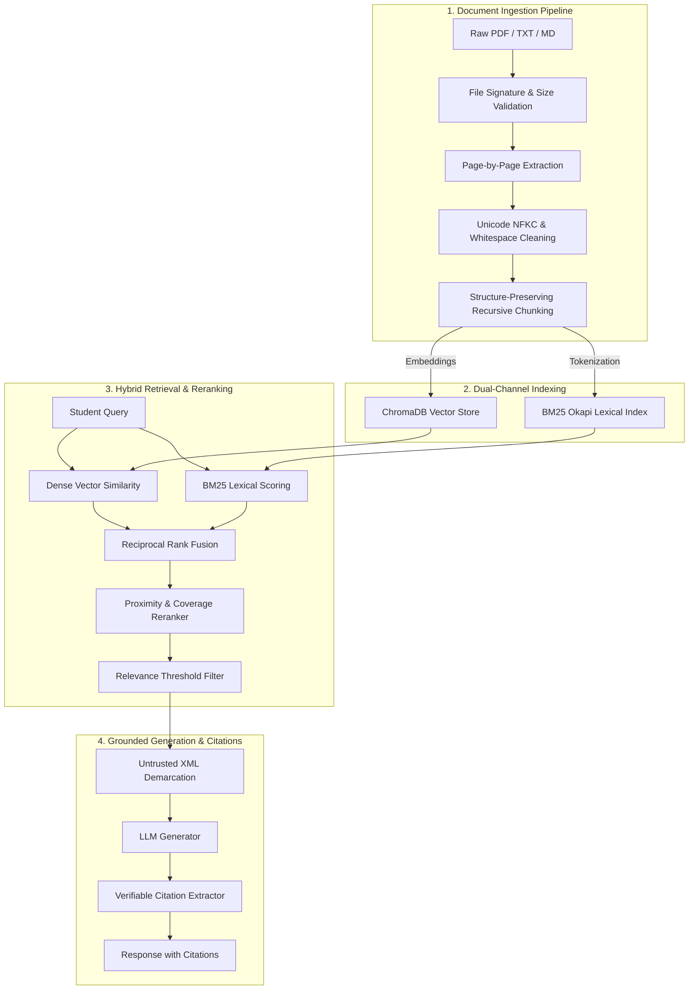

# EduPath AI - Advanced RAG Architecture Specification

> **System Component:** Retrieval-Augmented Generation Engine (SIH25094)  
> **Retrieval Paradigm:** Dense Vector + BM25 Lexical Hybrid Search with Reciprocal Rank Fusion & Reranking

---

## 1. Architectural Overview

The EduPath AI RAG pipeline bridges static student profile data with dynamic, verified educational curricula and industry career frameworks. It is designed to completely prevent hallucinated qualifications, course recommendations, and career requirements.



---

## 2. Ingestion & Preprocessing

### Document Extraction (`rag/extraction.py`)
- **PDF Extraction:** Extracts page-by-page text using `pypdf.PdfReader`, preserving page indices for citations.
- **Plaintext & Markdown:** Reads UTF-8 encoded text with automatic replacement fallback for malformed bytes.

### Text Cleaning & Normalization (`rag/cleaning.py`)
- Unicode NFKC normalization.
- Replaces non-breaking spaces (`\xa0`) and zero-width spaces (`\u200b`).
- Collapses duplicate spaces and line breaks while preserving paragraph boundaries (`\n\n`).

### Recursive Chunking (`rag/chunking.py`)
- Baseline chunk size: **500 characters** with an overlap of **50 characters**.
- Separator hierarchy:
  1. Paragraph boundary: `\n\n`
  2. Line boundary: `\n`
  3. Sentence boundary: `. `
  4. Clause boundary: `; `, `, `
  5. Word boundary: ` `
- Every chunk is wrapped in a `DocumentChunk` object enriched with metadata:
  - `doc_id`: Unique document identifier derived from SHA-256 content hash.
  - `source`: Sanitized filename.
  - `page_number`: Extracted document page.
  - `chunk_index`: Monotonic sequence number within document.
  - `user_id`: Owning student ID or `"global"`.
  - `is_global`: Boolean visibility flag.

---

## 3. Pluggable Embeddings Architecture (`rag/embeddings.py`)

EduPath AI decouples the embedding model from external LLM providers:
1. **OfflineDeterministicEmbeddings (Default):**
   - High-dimensional (384-dim) subword n-gram and token feature hashing with sign hash.
   - Normalized using $L_2$ vector norm ($\|\mathbf{v}\|_2 = 1.0$), ensuring that the inner product directly computes cosine similarity:
     $$\text{CosineSim}(\mathbf{u}, \mathbf{v}) = \sum_{i=1}^{384} u_i \cdot v_i$$
   - 100% offline, zero-network, zero-download, and perfectly deterministic.
2. **Google Gemini Embeddings (`models/text-embedding-004`):**
   - Cloud-native 768-dim embeddings via Google GenAI API when credentials are provided.
3. **FastEmbed / Local Transformers:**
   - Pre-configured extension points for ONNX-quantized local embedding models.

---

## 4. Vector Storage & Isolation (`rag/vector_store.py`)

- **ChromaDB Client:** Persistent client storage at `data/chroma_db`.
- **User-Level Metadata Filtering:** Queries enforce tenant separation:
  ```python
  where_filter = {
      "$or": [
          {"user_id": current_user_id},
          {"is_global": True}
      ]
  }
  ```
- **Duplicate Prevention:** Content hashes determine unique chunk IDs, enabling atomic upserts.

---

## 5. Dual-Channel Hybrid Search & Reranking

### Dense Semantic Search
Measures conceptual proximity between query and stored vector spaces.

### Sparse Lexical Search (`rag/bm25_search.py`)
Indexes word frequencies using the **BM25 Okapi** algorithm:
$$\text{Score}(D, Q) = \sum_{i=1}^{N} \text{IDF}(q_i) \cdot \frac{f(q_i, D) \cdot (k_1 + 1)}{f(q_i, D) + k_1 \cdot \left(1 - b + b \cdot \frac{|D|}{\text{avgdl}}\right)}$$

### Fusion Strategies (`rag/hybrid_search.py`)
1. **Reciprocal Rank Fusion (RRF):**
   Combines rankings across disparate score distributions:
   $$\text{RRF}(d) = \sum_{m \in M} \frac{1}{60 + \text{Rank}_m(d)}$$
2. **Linear Weighted Fusion:**
   $$S_{\text{hybrid}} = \alpha \cdot S_{\text{dense}} + (1 - \alpha) \cdot S_{\text{sparse}} \quad (\alpha = 0.6)$$

### Candidate Reranker (`rag/reranker.py`)
Reranks the top candidates using query term proximity, exact coverage, and semantic alignment:
$$S_{\text{rerank}} = 0.3 \cdot S_{\text{hybrid}} + 0.4 \cdot \text{Coverage}(Q, C) + 0.3 \cdot \text{Proximity}(Q, C)$$
Chunks falling below `RELEVANCE_THRESHOLD = 0.25` are pruned to eliminate irrelevant noise.

---

## 6. Verifiable Citations (`rag/citations.py`)

Every generated recommendation and Q&A answer cites source evidence:
```markdown
### 📚 Verified Sources & Citations:
- **[1] official_career_standards_sih.md** (Page 1) — *"Foundational requirements include advanced Python programming, linear algebra..."* (Relevance: 0.85)
```
Answers explicitly state when retrieved context is insufficient rather than fabricating unsupported claims.
