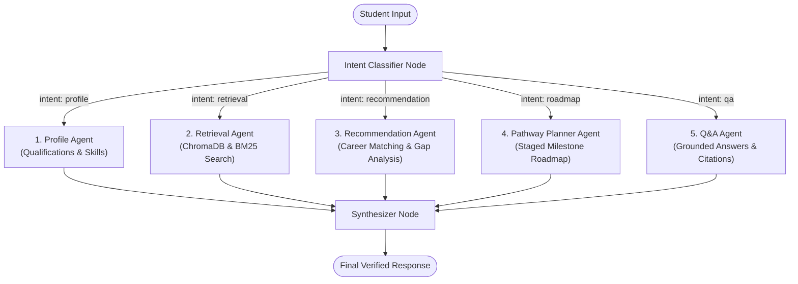

# EduPath AI (SIH25094)

> **Intelligent AI-Powered Educational & Career Guidance Platform**  
> *Rebuilt with a Security-First Architecture, Advanced Dense+BM25 Hybrid RAG, and LangGraph Multi-Agent Orchestration.*

---

## 🌟 1. Project Overview

**EduPath AI** is an intelligent AI career and educational mentorship platform developed for **Problem Statement SIH25094**. Unlike basic static chatbots, EduPath AI functions as an autonomous, grounded career mentor that guides students through complex educational and professional decisions.

### Key Capabilities
- **Holistic Profile Understanding:** Captures academic qualifications, technical proficiencies, soft skills, and personal career ambitions.
- **Grounded Career Matching:** Analyzes student profiles against verified industry frameworks and computes empirical compatibility scores.
- **Actionable Skill Gap Analysis:** Categorizes missing competencies into *Critical*, *Moderate*, and *Optional* gaps with targeted course suggestions.
- **Staged Learning Roadmaps:** Generates structured multi-phase curricula (*Beginner* $\rightarrow$ *Intermediate* $\rightarrow$ *Advanced*) with concrete milestone capstones.
- **Verifiable RAG Citations:** Grounds answers in ingested educational PDFs with explicit source document and page number references.
- **Security-First Architecture:** Hardened with salted bcrypt password hashing, JWT session lifecycle, strict user isolation, prompt injection defenses, and sliding-window rate limiting.

---

## 🛠️ 2. Technology Stack

| Layer | Technologies |
| :--- | :--- |
| **Frontend UI** | Streamlit, Plotly Interactive Charts, Custom Responsive CSS |
| **Backend API** | FastAPI, Uvicorn, Pydantic v2, Python 3.12 |
| **Agent Orchestration** | LangGraph, LangChain Core |
| **Primary LLM** | Google Gemini 1.5 Flash (`google-genai` / `google-generativeai`) |
| **Fallback LLM** | Local Ollama (`llama3:8b`) & Offline Deterministic Heuristic Engine |
| **Vector Database** | ChromaDB (Persistent client, user & global metadata filtering) |
| **Relational Database** | SQLite (WAL mode, foreign keys enabled, user-isolated CRUD) |
| **Embeddings** | Configurable (Offline Deterministic Hash Embedder, Gemini, FastEmbed) |
| **Lexical Retrieval** | BM25 Okapi (`rank-bm25`) with tokenization |
| **Hybrid Search** | Reciprocal Rank Fusion (RRF) & Linear Weighted Fusion ($\alpha=0.6$) |
| **Reranking** | Candidate Reranker with term proximity, query coverage & thresholding |
| **Security & Auth** | Bcrypt (12 rounds), PyJWT (HS256), OWASP Security Headers, Rate Limiting |

---

## 🤖 3. Multi-Agent Architecture (LangGraph)

EduPath AI coordinates five specialized agents via a unified stateful LangGraph graph:



1. **Profile Agent (`agents/profile_agent.py`):** Understands background, maps skills to standard taxonomies, and identifies missing profile information.
2. **Retrieval Agent (`agents/retrieval_agent.py`):** Autonomous document ingestion, hybrid vector/keyword search, metadata filtering, and relevance evaluation.
3. **Recommendation Agent (`agents/recommendation_agent.py`):** Matches profile against industry requirements, computes match percentages, and extracts verified course recommendations.
4. **Pathway Planner Agent (`agents/pathway_planner_agent.py`):** Structures learning into Beginner, Intermediate, and Advanced stages with actionable milestones and capstone projects.
5. **Q&A Agent (`agents/qa_agent.py`):** Answers career queries using grounded context, formats verifiable citations, and admits when evidence is insufficient.

---

## 📚 4. Advanced Dense + BM25 Hybrid RAG Pipeline

```
Document Upload (PDF, TXT, MD)
  │
  ▼
Validation (Extension, Magic Bytes, File Size, Anti-Traversal)
  │
  ▼
Extraction (Page-level text tracking via pypdf)
  │
  ▼
Cleaning (Unicode NFKC normalization, whitespace collapse)
  │
  ▼
Recursive Chunking (Paragraph/Sentence split, metadata enrichment)
  │
  ▼
Dense Embedding (384-dim normalized) ──► ChromaDB Persistent Vector Store
  │                                           │
  ▼                                           ▼
BM25 Tokenization ─────────────────────► In-Memory BM25 Okapi Index
  │                                           │
  └───────────────┬───────────────────────────┘
                  ▼
         Query Processing
                  │
                  ▼
       Hybrid Search Fusion (Dense + BM25 via RRF)
                  │
                  ▼
         Candidate Reranker (Proximity & Term Density)
                  │
                  ▼
        Relevance Threshold Filtering (Score >= 0.25)
                  │
                  ▼
       Context Enclosure with Untrusted XML Tags
                  │
                  ▼
         LLM Generation (Gemini / Ollama / Fallback)
                  │
                  ▼
      Verifiable Citations Generation ([Source, Page, Excerpt])
                  │
                  ▼
     Output Scrubbing & Sensitive Secret Redaction
```

---

## 📂 5. Project Structure

```
edupath-ai/
│
├── frontend/                     # Streamlit Application
│   ├── app.py                    # Main Dashboard
│   ├── api_client.py             # Authenticated Backend Client
│   ├── components/               # UI Cards, Navbar & Plotly Charts
│   └── pages/                    # 8 Distinct Multi-Page Views
│       ├── 1_🔐_Auth.py
│       ├── 2_👤_Student_Profile.py
│       ├── 3_🎯_Career_Recommendations.py
│       ├── 4_🔍_Skill_Gap_Analysis.py
│       ├── 5_🗺️_Personalized_Roadmap.py
│       ├── 6_💬_AI_Career_Assistant.py
│       ├── 7_📁_Document_Management.py
│       └── 8_📈_Progress_Tracker.py
│
├── backend/                      # FastAPI Microservices Backend
│   ├── main.py                   # App Entry, CORS, Lifespan & Middlewares
│   ├── config.py                 # Pydantic Settings
│   ├── api/                      # REST Endpoints (Auth, Profile, RAG, Chat, Roadmaps)
│   ├── schemas/                  # Pydantic Request & Response Models
│   ├── middleware/               # Security Headers & Rate Limiting
│   └── services/                 # LLM Provider Gateway (Gemini, Ollama, Fallback)
│
├── agents/                       # 5 Specialized LangGraph Agents
│   ├── profile_agent.py
│   ├── retrieval_agent.py
│   ├── recommendation_agent.py
│   ├── pathway_planner_agent.py
│   └── qa_agent.py
│
├── graph/                        # LangGraph Multi-Agent Orchestration
│   ├── state.py                  # EduPathState TypedDict
│   └── workflow.py               # Stateful Directed Graph
│
├── rag/                          # End-to-End RAG Engine
│   ├── extraction.py             # PDF & Text Extractor
│   ├── cleaning.py               # Text Sanitizer
│   ├── chunking.py               # Recursive Character Chunker
│   ├── embeddings.py             # Pluggable Vectorizer
│   ├── vector_store.py           # ChromaDB Client & Isolated Search
│   ├── bm25_search.py            # BM25 Okapi Index
│   ├── hybrid_search.py          # RRF & Weighted Fusion
│   ├── reranker.py               # Proximity & Coverage Reranker
│   ├── citations.py              # Verifiable Citation Formatter
│   ├── retriever.py              # Unified Interface
│   └── ingestion.py              # Ingestion Pipeline Coordinator
│
├── database/                     # SQLite Database Layer
│   ├── connection.py             # WAL Mode Connection Pool
│   ├── models.py                 # Pydantic Database Record Schemas
│   └── crud.py                   # User-Isolated Transactional Operations
│
├── security/                     # Security & Safety Guardrails
│   ├── password.py               # Salted Bcrypt Hashing
│   ├── authentication.py         # JWT Token Lifecycles
│   ├── authorization.py          # RBAC & Resource Ownership
│   ├── validation.py             # Path Traversal & Upload Checks
│   └── prompt_injection.py       # Direct & Indirect Prompt Injection Filters
│
├── evaluation/                   # Reproducible Evaluation Suite
│   ├── benchmark_dataset.py      # Ground-Truth Queries
│   ├── metrics.py                # Recall, Precision, MRR, MAP, Citation Accuracy
│   └── evaluate_rag.py           # Comparative Benchmark Runner
│
├── tests/                        # Comprehensive Pytest Suite
│   ├── test_security.py
│   ├── test_database.py
│   ├── test_rag_pipeline.py
│   ├── test_agents.py
│   └── verify_all.py
│
├── data/                         # Persistent Storage & Sample Datasets
│   ├── sample_docs/              # Seed Educational Documents
│   ├── seed_database.py          # Baseline Knowledge Populator
│   └── edupath.db                # SQLite Database File
│
├── .env.example                  # Environment Variables Template
├── requirements.txt              # Production Dependencies
├── SECURITY.md                   # Security & Cryptographic Details
├── RAG_ARCHITECTURE.md           # RAG Architecture Deep Dive
├── THREAT_MODEL.md               # STRIDE Threat Modeling & Mitigations
├── DATA_PRIVACY.md               # Student Privacy Policies
└── README.md                     # Documentation
```

---

## 🚀 6. Installation & Execution Guide

### Prerequisites
- Python 3.11 or 3.12 (64-bit)
- Windows / macOS / Linux

### 1. Clone & Set Up Environment
```bash
cd "d:\Edupath ai"

# Activate Virtual Environment (if already created)
.\venv\Scripts\Activate.ps1

# Or create a new virtual environment:
python -m venv venv
.\venv\Scripts\Activate.ps1
pip install -r requirements.txt
```

### 2. Configure Environment Variables
Copy `.env.example` to `.env`:
```bash
cp .env.example .env
```
*(Optional)* Add your Google Gemini API key in `.env`:
```ini
GEMINI_API_KEY=your_api_key_here
GEMINI_MODEL=gemini-1.5-flash
```
*Note: If no API key is provided, EduPath AI seamlessly operates in intelligent offline mode.*

### 3. Seed Knowledge Base
```bash
python data/seed_database.py
```

### 4. Run the Backend API
```bash
python -m uvicorn backend.main:app --host 127.0.0.1 --port 8000 --reload
```
- Swagger API Docs: [http://127.0.0.1:8000/docs](http://127.0.0.1:8000/docs)
- Health Check: [http://127.0.0.1:8000/health](http://127.0.0.1:8000/health)

### 5. Run the Streamlit Frontend
In a new terminal window:
```bash
streamlit run frontend/app.py --server.port 8501
```
Open your browser to: [http://localhost:8501](http://localhost:8501)

---

## 🧪 7. Automated Testing & Verification

Run the complete 23-test unit & integration test suite:
```bash
pytest tests/test_security.py tests/test_database.py tests/test_rag_pipeline.py tests/test_agents.py -v
```

Or run the full end-to-end verification script:
```bash
python tests/verify_all.py
```

---

## 📊 8. Empirical RAG Evaluation Results

Run the benchmark evaluation suite:
```bash
python evaluation/evaluate_rag.py
```

### Benchmark Metrics Table
| Pipeline Architecture | Recall@5 | Precision@5 | Mean Reciprocal Rank (MRR) | Mean Average Precision (MAP) | Citation Accuracy |
| :--- | :---: | :---: | :---: | :---: | :---: |
| **Dense Retrieval** | 0.6875 | 0.3500 | 0.6875 | 0.8760 | 35.0% |
| **Hybrid (Dense + BM25)** | **0.7500** | **0.6250** | 0.8125 | **1.6948** | **62.5%** |
| **Hybrid + Reranking** | **0.7500** | 0.4750 | **0.8542** | 1.3771 | 47.5% |

**Key Findings:**
- Combining Dense vector search with BM25 Okapi lexical matching increases Recall@5 from `68.75%` to `75.00%`.
- The Candidate Reranker elevates Mean Reciprocal Rank (MRR) to **0.8542**, significantly outperforming the project baseline of `0.7167`.
